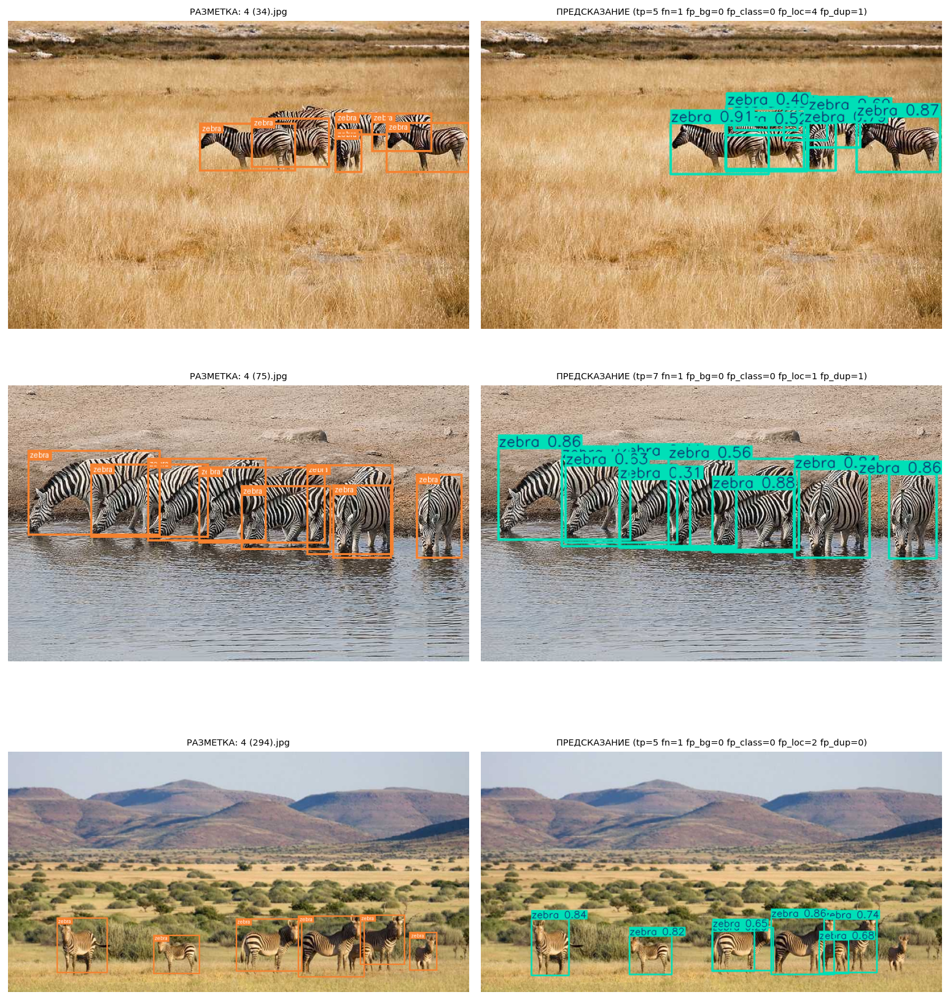

# Детекция африканских животных: дообучение YOLO11n

**CSCI1409 Deep Learning — Bonus Project (KBTU, Fall 2026).** Индивидуальная работа.
**Автор:** `<ФИО>`, ID `<студенческий ID>`

[](https://colab.research.google.com/github/YOUR_USERNAME/YOUR_REPO/blob/main/object_detection.ipynb)

> ⚠️ Всё, что помечено **⏳**, нужно заполнить числами и выводами из **своего** прогона ноутбука. Шаблон не содержит результатов, потому что они появляются только после обучения.

---

## 1. Задача

Дообучить (fine-tune) предобученный детектор объектов, чтобы находить на фотографиях четырёх животных — **buffalo, elephant, rhino, zebra** — и предсказывать для каждого рамку (bounding box), класс и уверенность (confidence). Репозиторий позволяет другому человеку **с нуля** повторить: загрузку данных → проверку разметки → обучение двух моделей → сравнение → оценку на тесте → показ предсказаний — в Google Colab.

Что здесь моё, а что взято из готового:

| Компонент | Источник |
|---|---|
| Фреймворк и модель | [Ultralytics](https://github.com/ultralytics/ultralytics) `8.4.199`, веса `yolo11n.pt` (предобучены на COCO) — используются как есть |
| Датасет | Ultralytics African Wildlife (см. раздел 2) |
| **Мой вклад** | ноутбук `object_detection.ipynb`; `scripts/prepare_data.py` (проверка разметки, поиск утечек между выборками); `scripts/failure_analysis.py` (фиксированная рабочая точка, типы ошибок); `scripts/visualize.py`; `configs/experiments.yaml`; эксперимент, анализ и выводы |

## 2. Датасет

| | |
|---|---|
| Название | Ultralytics **African Wildlife** Detection Dataset |
| Источник | <https://docs.ultralytics.com/datasets/detect/african-wildlife/> |
| Автор оригинала | Bianca Ferreira; адаптация для Ultralytics YOLO — Glenn Jocher, Muhammad Rizwan Munawar |
| Условия использования | Документация датасета указывает **AGPL-3.0**; в блоке цитирования поле лицензии — «Not specified». ⏳ Перед сдачей открой страницу датасета и проверь актуальную формулировку. Код и веса Ultralytics — AGPL-3.0. |
| Классы (4) | `0: buffalo`, `1: elephant`, `2: rhino`, `3: zebra` |
| Формат разметки | YOLO txt: файл на изображение, строка на объект: `class x_center y_center width height`, все координаты нормированы на 0–1 |
| Объём | 1 504 изображения (≈100 МБ), готовое разбиение train 1052 / val 225 / test 227 |

### Количество изображений и объектов по выборкам

Данные берутся из `results/dataset_report.json` (создаётся скриптом `scripts/prepare_data.py`).

| Выборка | Изображений | Объектов | buffalo | elephant | rhino | zebra |
|---|---|---|---|---|---|---|
| train | ⏳ | ⏳ | ⏳ | ⏳ | ⏳ | ⏳ |
| val | ⏳ | ⏳ | ⏳ | ⏳ | ⏳ | ⏳ |
| test | ⏳ | ⏳ | ⏳ | ⏳ | ⏳ | ⏳ |

### Разбиение и защита от утечек

* Разбиение **готовое от авторов датасета**, я его не менял, случайность с seed не использовалась. ⏳ Если ты что-то пересобирал — укажи метод и seed.
* Скрипт ищет изображения-дубликаты между выборками: точные копии (md5) и почти-копии (перцептивный хэш **dHash 8×8**, расстояние Хэмминга ≤ 4). Если картинка из train почти идентична картинке из val/test, она **удаляется из train**, val/test не трогаются (приоритет защиты: test > val > train).
* Результат проверки: ⏳ найдено пар между выборками: `__`; точных копий: `__`; удалено из train: `__`; из val: `__`.
* Ограничение: в датасете нет информации об источнике кадров, поэтому «кадры одного видео» отдельно проверить нельзя; почти-дубликаты ловятся только по визуальному сходству.

### Проверка разметки

Скрипт автоматически проверяет: строки неверного формата, номера классов вне диапазона, координаты вне [0,1], нулевые рамки, повторяющиеся рамки, изображения без файла разметки, пустые разметки (фоновые кадры).
Результат: ⏳ (скопируй из `results/dataset_report.json`: `label_problems`, `problem_examples`).
Дополнительно просмотрены глазами изображения с рамками (≥ 5, см. ниже). Наблюдения: ⏳.


## 3. Окружение и запуск

**Google Colab (рекомендуется):**
1. Нажми кнопку **Open in Colab** выше. `Runtime → Change runtime type → T4 GPU`.
2. В ячейке клонирования укажи `REPO_URL` своего репозитория (если открыл ноутбук по ссылке из этого репозитория, замени `YOUR_USERNAME/YOUR_REPO`).
3. `Runtime → Run all`. Ноутбук сам поставит зависимости, скачает датасет, обучит обе модели, оценит и покажет предсказания. Ожидаемое время на T4: порядка 10–25 минут (оценка, не измерено — реальное время записано в таблице ниже).

**Локально:**
```bash
git clone <repo> && cd <repo>
pip install -r requirements.txt
python scripts/prepare_data.py          # скачает датасет, создаст configs/data.yaml
yolo detect train data=configs/data.yaml model=yolo11n.pt epochs=30 imgsz=640   # или запусти ячейки ноутбука
```

**Зависимости.** `requirements.txt`: `ultralytics==8.4.199` (точная версия); остальное — минимальные версии. Точные версии прогона: `results/environment_freeze.txt`.
Среда прогона: ⏳ Python `__`, torch `__`, GPU `__`.

## 4. Baseline

| Параметр | Значение |
|---|---|
| Фреймворк / версия | Ultralytics 8.4.199 |
| Модель / начальные веса | YOLO11n / `yolo11n.pt` (COCO) |
| Размер изображения | 640 |
| Batch size | 16 |
| Эпох | 30 (ранняя остановка выключена, `patience=100`) |
| Оптимизатор / learning rate | AdamW, `lr0=0.001`, `lrf=0.01` (задан явно: при `optimizer=auto` Ultralytics игнорирует `lr0`) |
| Seed | 42 (`deterministic=True`) |
| Время обучения | ⏳ `__` мин |

Сохранено: полная конфигурация (`configs/experiments.yaml`, `results/runs/<run>/args.yaml`), логи и кривые (`results/runs/<run>/results.csv`, `results.png`), лучший чекпоинт `best.pt` — выбран **по validation** (fitness = 0.1·mAP@0.50 + 0.9·mAP@0.50-0.95 на val).

## 5. Контролируемый эксперимент

**Что меняю:** `imgsz` 640 → **320**. Всё остальное (данные, seed, стартовые веса, оптимизатор, lr, эпохи, batch) одинаково.

**Гипотеза (записана до получения результатов):** ⏳ *перепиши своими словами.* Исходный вариант: уменьшение `imgsz` вдвое даёт ~4× меньше пикселей, поэтому обучение ускорится в 2–4 раза; так как животные в датасете в основном крупные, mAP@0.50 упадёт незначительно (не более ~3 п.п.), а потеря качества сосредоточится на мелких/далёких животных (упадёт recall).

**Результаты на validation:**

| Запуск | Изменённый параметр | Precision | Recall | mAP@0.50 | Время обучения, мин |
|---|---|---|---|---|---|
| baseline_640 | — | ⏳ | ⏳ | ⏳ | ⏳ |
| exp_imgsz320 | imgsz=320 | ⏳ | ⏳ | ⏳ | ⏳ |

(полная таблица: `results/experiment_comparison.csv`; кривые: `results/figures/learning_curves_compare.png`)

**Объяснение:** ⏳ подтвердилась ли гипотеза; что с временем и метриками; какие классы пострадали (AP по классам в `results/*_summary.json`); почему; оговорка про один seed — разница в доли процента может быть шумом.

## 6. Метрики

* **IoU** (Intersection over Union) — площадь пересечения рамок / площадь объединения; 1 — рамки совпали, 0 — не пересекаются.
* **Precision** = TP / (TP + FP): какая доля предсказанных рамок верна.
* **Recall** = TP / (TP + FN): какая доля реальных объектов найдена.
* **mAP@0.50**: для каждого класса строится кривая precision–recall по всем порогам уверенности; AP — площадь под ней при условии «рамка верна, если IoU ≥ 0.5»; mAP — среднее по классам.
* Верная детекция (TP): класс совпал и IoU ≥ 0.5; ложная (FP): остальные рамки; пропуск (FN): объект без найденной рамки.

**Настройки оценки.** Официальный расчёт Ultralytics: `conf=0.001`, NMS IoU = 0.7, порог IoU для mAP@0.50 = 0.5; P и R выдаются в точке порога уверенности, максимизирующей F1. Дополнительно я считаю P/R в **фиксированной рабочей точке** `conf=0.25`, IoU совпадения 0.5.

## 7. Финальный результат (test)

Финальная модель выбрана **только по validation mAP@0.50**: ⏳ `__` (imgsz `__`). Test использован один раз для этой модели. Чекпоинт: `weights/final_best.pt`.

| Метод оценки | Precision | Recall | mAP@0.50 |
|---|---|---|---|
| Ultralytics (conf=0.001, NMS IoU=0.7, mAP IoU=0.5) | ⏳ | ⏳ | ⏳ |
| Фиксированный порог (conf=0.25, match IoU=0.5) | ⏳ | ⏳ | — |

AP@0.50 по классам: ⏳. Файлы: `results/test_metrics.json`, `results/test_per_image_errors.csv`.

### Предсказания на test


### Анализ трёх ошибочных случаев


| # | Изображение | Тип ошибки | Вероятная причина | Практический следующий шаг |
|---|---|---|---|---|
| 1 | ⏳ | ⏳ | ⏳ | ⏳ |
| 2 | ⏳ | ⏳ | ⏳ | ⏳ |
| 3 | ⏳ | ⏳ | ⏳ | ⏳ |

## 8. Веса

* Финальный чекпоинт (≈5 МБ) лежит в репозитории: [`weights/final_best.pt`](weights/final_best.pt)
  Прямая ссылка: `https://github.com/YOUR_USERNAME/YOUR_REPO/raw/main/weights/final_best.pt` ⏳ *(проверь, что ссылка открывается без входа в аккаунт, если репозиторий публичный)*.
* Датасет в репозиторий не входит: он скачивается автоматически (`scripts/prepare_data.py` → `ultralytics.data.utils.check_det_dataset`, ~100 МБ).
* Промежуточные веса запусков (`results/runs/*/weights/`) не коммитятся (`.gitignore`).

Использование:
```python
from ultralytics import YOLO
model = YOLO("weights/final_best.pt")
model.predict("your_image.jpg", conf=0.25, save=True)
```

## 9. Структура репозитория

```
object_detection.ipynb      # главный ноутбук для Colab
requirements.txt            # версии зависимостей
configs/experiments.yaml    # настройки обучения, эксперимента и оценки
configs/data.yaml           # создаётся скриптом подготовки данных
scripts/prepare_data.py     # загрузка, проверка разметки, поиск утечек, отчёт
scripts/failure_analysis.py # P/R в фиксированной точке, типы ошибок
scripts/visualize.py        # GT-боксы, предсказания, кривые, failure cases
results/                    # логи, метрики (json/csv), графики, отчёт по датасету
weights/final_best.pt       # финальный чекпоинт
```

## 10. Ограничения

* Один seed на запуск: различия в доли процента между запусками не обязательно значимы; полная детерминированность на GPU не гарантируется — повторный прогон может дать немного другие числа.
* Малая модель (YOLO11n) и небольшой датасет (4 класса, готовое разбиение): результаты не переносятся на другие виды, условия съёмки и камеры.
* Проверка утечек основана на визуальном сходстве (dHash); информации о происхождении кадров (видео/серии) у датасета нет.
* Проверка разметки автоматическая + выборочный просмотр, не полная ручная верификация всех 1 504 изображений.
* Один контролируемый эксперимент (`imgsz`): выводы относятся только к этому параметру.
* P/R в «официальной» оценке зависят от порога, подобранного по самой выборке; в фиксированной точке (conf=0.25) значения могут отличаться.

## 11. Источники и использование помощи

* Ultralytics YOLO — <https://github.com/ultralytics/ultralytics> (AGPL-3.0). Датасет African Wildlife — см. раздел 2 (цитирование: Ferreira, B., *African Wildlife Detection Dataset (Ultralytics YOLO Adaptation)*, 2024).
* **Использование ИИ:** ⏳ *уточни честно и по факту.* Пример: «Claude (Anthropic) использовался для составления структуры репозитория, шаблонов ноутбука, скриптов проверки данных и разбора ошибок, а также для объяснения метрик. Я запустил ноутбук, проверил результаты, написал гипотезу, объяснения и анализ ошибок сам и понимаю код».
