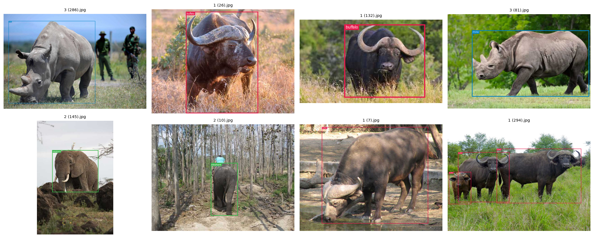
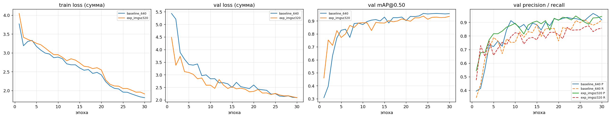
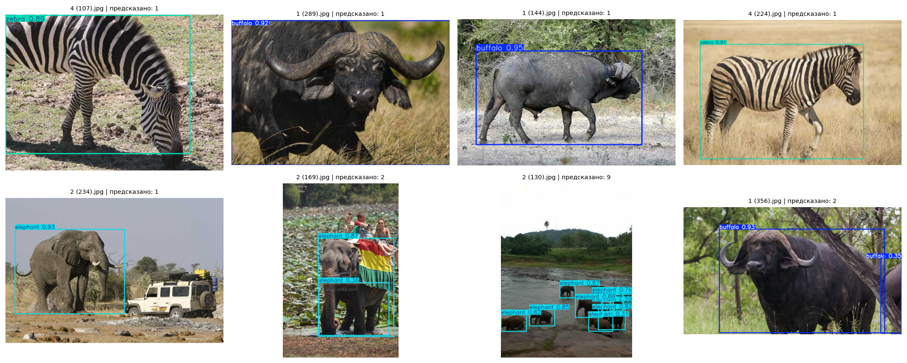

# African Wildlife Detection: Fine-tuning YOLO11n

**CSCI1409 Deep Learning, Bonus Project (KBTU, Fall 2026). Individual work.**
**Author:** Olzhabay Sabyrzhan, student ID **23B031132**

[](https://colab.research.google.com/github/sabyrzhaan/deeplearningnovembertask/blob/main/object_detection.ipynb)

---

## 1. Task

Fine-tune a pretrained object detector to find four kinds of animals in photographs: **buffalo, elephant, rhino, zebra**. For each object the model predicts a bounding box, a class and a confidence score. The repository lets anyone repeat the whole pipeline in Google Colab from a fresh runtime: data download → label and leakage checks → training two models → comparison → test evaluation → predictions and error analysis.

What is reused and what is mine:

| Component | Source |
|---|---|
| Framework and model | [Ultralytics](https://github.com/ultralytics/ultralytics) `8.4.199`, weights `yolo11n.pt` (pretrained on COCO), used as is |
| Dataset | Ultralytics African Wildlife (section 2) |
| **My additions** | notebook `object_detection.ipynb`; `scripts/prepare_data.py` (label checks, duplicate detection between splits); `scripts/failure_analysis.py` (metrics at a fixed operating point, error types); `scripts/visualize.py`; `configs/experiments.yaml`; the experiment, analysis and conclusions |

## 2. Dataset

| | |
|---|---|
| Name | Ultralytics **African Wildlife** Detection Dataset |
| Source | <https://docs.ultralytics.com/datasets/detect/african-wildlife/> |
| Original author | Bianca Ferreira; adapted for Ultralytics YOLO by Glenn Jocher and Muhammad Rizwan Munawar |
| Terms of use | The dataset documentation states the **AGPL-3.0** license; the citation block lists the license as "Not specified". Ultralytics code and weights are AGPL-3.0. The dataset is used here for educational purposes. |
| Classes (4) | `0: buffalo`, `1: elephant`, `2: rhino`, `3: zebra` |
| Annotation format | YOLO txt: one file per image, one line per object: `class x_center y_center width height`, coordinates normalized to 0–1 |
| Original size | 1,504 images (about 100 MB); provided split: train 1052 / val 225 / test 227 |

### Images and objects per split (after leakage cleanup)

| Split | Images | Objects | buffalo | elephant | rhino | zebra |
|---|---|---|---|---|---|---|
| train | 1021 | 1881 | 379 | 551 | 388 | 563 |
| val | 223 | 377 | 89 | 91 | 83 | 114 |
| test | 227 | 375 | 66 | 99 | 75 | 135 |

The median box covers about 21–23% of the image area (train 0.206, val 0.226, test 0.220), so objects are mostly large.

### Split method and leakage control

* The split is the **one provided by the dataset authors**; I did not create a random split with a seed.
* I checked the split for duplicates between sets: exact copies (md5) and near-duplicates (perceptual hash **dHash 8×8**, Hamming distance ≤ 4).
* **Result:** **33 pairs** of identical or near-identical images were found in different splits, **20 of them exact copies**. **31** images were removed from train and **2** from val; test was not modified (protection priority: test > val > train). After cleanup: train 1021, val 223, test 227. The remaining file lists are in `configs/train_dedup.txt` and `configs/val_dedup.txt`; the full report is in `results/dataset_report.json`.
* Limitation: the dataset gives no information about the origin of frames (series, videos), so the requirement about frames from the same video cannot be checked directly; near-duplicates are caught only by visual similarity. The dHash threshold of ≤ 4 may have produced a few false positives among the 13 non-exact pairs; the 20 exact copies cannot be false positives.

### Label checks

The automatic check (`scripts/prepare_data.py`) found no problems: 0 malformed lines, 0 class ids out of range, 0 coordinates outside [0,1], 0 zero-size or repeated boxes, 0 images without a label file, 0 empty label files. I also inspected images with their boxes visually (see below). Observation: in dense groups of animals (for example the zebras in `test/4 (34).jpg` and `test/4 (75).jpg`) the ground-truth boxes overlap heavily and in places look duplicated, so annotation in such scenes is ambiguous; this may affect the localization scores.



## 3. Environment and how to run

**Google Colab (recommended):**
1. Click **Open in Colab** (badge above). `Runtime → Change runtime type → T4 GPU`.
2. `Runtime → Run all`. The notebook clones the repository, installs dependencies, downloads the dataset, trains both models, evaluates them and shows predictions. If Colab asks for a restart after installing dependencies, restart and run the cells again.
3. The repository must be public (or otherwise clonable without login).

The explanatory text inside the notebook is written in Russian; the code, outputs and this README are what matter for reproduction.

**Locally:**
```bash
git clone https://github.com/sabyrzhaan/deeplearningnovembertask.git
cd deeplearningnovembertask
pip install -r requirements.txt
python scripts/prepare_data.py     # downloads the dataset, creates configs/data.yaml and the report
# then run the cells of object_detection.ipynb (Jupyter)
```

**Dependencies:** `requirements.txt` pins `ultralytics==8.4.199` exactly; other packages have minimum versions. Exact versions of my run: `results/environment_freeze.txt`.
**My run environment:** Python 3.13.16, torch 2.14.1+cu130, Ultralytics 8.4.199, Tesla T4 GPU (Google Colab).

## 4. Baseline

| Parameter | Value |
|---|---|
| Framework / version | Ultralytics 8.4.199 |
| Model / initial weights | YOLO11n / `yolo11n.pt` (COCO) |
| Image size | 640 |
| Batch size | 16 |
| Epochs | 30 (early stopping disabled: `patience=100`) |
| Optimizer / learning rate | AdamW, `lr0=0.001`, `lrf=0.01` (set explicitly: with `optimizer=auto` Ultralytics ignores `lr0`) |
| Seed | 42 (`deterministic=True`) |
| Training time | 9.03 min (Tesla T4) |

Saved: configuration (`configs/experiments.yaml`, `results/runs/<run>/args.yaml`), training logs and curves (`results/runs/<run>/results.csv`, `results.png`), and the best checkpoint `best.pt`. Ultralytics selects it **by validation** (fitness = 0.1·mAP@0.50 + 0.9·mAP@0.50-0.95 on val).

## 5. Controlled experiment

**What changes:** `imgsz` 640 → **320**. Everything else (data, seed, initial weights `yolo11n.pt`, optimizer, learning rate, epochs, batch size) is identical.

**Hypothesis (written before seeing results):** halving `imgsz` gives about 4× fewer pixels, so training should be 2–4× faster. Because the animals in this dataset are mostly large (median box about 21% of the frame), mAP@0.50 should drop only slightly (no more than about 3 percentage points), and the loss should be concentrated on small and distant animals (recall should drop).

**Validation results:**

| Run | Changed setting | Precision | Recall | mAP@0.50 | Training time, min |
|---|---|---|---|---|---|
| baseline_640 | none | 0.920 | 0.919 | 0.958 | 9.03 |
| exp_imgsz320 | imgsz=320 | 0.935 | 0.862 | 0.935 | 5.53 |

Per-class AP@0.50 (val): baseline: buffalo 0.976, elephant 0.946, rhino 0.968, zebra 0.943; imgsz=320: buffalo 0.953, elephant 0.902, rhino 0.948, zebra 0.938. Inference time on val: 4.01 ms vs 2.78 ms per image.
Full table: `results/experiment_comparison.csv`; curves: `results/figures/learning_curves_compare.png`.



**Explanation: the hypothesis was partly confirmed.**
* *Confirmed:* mAP@0.50 dropped by 2.3 points (below the 3-point threshold); the loss came mainly from recall (−5.7 points), while precision rose (+1.5 points): the model became more conservative, producing fewer boxes that were more often correct.
* *Not confirmed:* training sped up by 1.63× (9.03 → 5.53 min), not 2–4×. A likely reason (not tested separately): resolution affects only the compute part, while data loading and augmentation on the CPU (`workers=2`), per-epoch validation and fixed overheads do not depend on it. Pure inference time dropped more noticeably (4.01 → 2.78 ms).
* *The explanation "small objects were lost" is not supported by the per-class numbers:* elephant dropped the most (−4.4 points AP@0.50) even though elephants are large. I did not investigate the cause.
* *Caveat:* one seed and a small validation set (223 images, 377 objects), so small differences (for example zebra −0.5 points) should not be treated as significant.

## 6. Metrics

* **IoU**: area of intersection of two boxes divided by area of their union; 1 means the boxes coincide, 0 means they do not overlap.
* **TP**: a box with the correct class and IoU ≥ 0.5 with a not-yet-matched object; **FP**: any other predicted box; **FN**: an object that no box found.
* **Precision** = TP / (TP + FP): the share of predicted boxes that are correct.
* **Recall** = TP / (TP + FN): the share of real objects that were found.
* **mAP@0.50**: for each class a precision–recall curve is built over all confidence thresholds; AP is the area under it, with a box counted as correct if IoU ≥ 0.5; mAP is the mean over classes. **mAP@0.50-0.95** averages over IoU thresholds from 0.5 to 0.95 and judges box accuracy more strictly.

**Evaluation settings.** Official Ultralytics evaluation: `conf=0.001` (almost all boxes are kept so the full curve can be built), NMS IoU = 0.7, IoU threshold for mAP@0.50 = 0.5; P and R are reported at the confidence threshold that maximizes F1 (a threshold chosen on the evaluated set itself). In addition (`scripts/failure_analysis.py`) I compute P/R at a **predefined operating point**: `conf=0.25`, NMS IoU = 0.7, matching IoU = 0.5.

## 7. Final result (test)

The final model is **baseline_640** (imgsz 640), chosen **only by validation mAP@0.50** (0.958 vs 0.935). The test set was used once, for this model only, and did not influence any training choice. Checkpoint: `weights/final_best.pt`.

| Evaluation method | Precision | Recall | mAP@0.50 |
|---|---|---|---|
| Ultralytics (conf=0.001, NMS IoU=0.7, mAP IoU=0.5) | 0.952 | 0.947 | **0.974** |
| Fixed threshold (conf=0.25, NMS IoU=0.7, match IoU=0.5) | 0.875 | 0.955 | n/a |

mAP@0.50-0.95 (Ultralytics): 0.826. Per-class AP@0.50 (test): buffalo 0.955, elephant 0.990, rhino 0.993, zebra 0.959.

**Error types at conf=0.25** (375 objects): 358 correct boxes, 17 missed objects; 51 false boxes: 24 inaccurate boxes with the right class, 16 on background, 10 duplicates, 1 wrong class. The model almost never confuses classes; the main errors are imprecise localization and extra boxes. Test mAP (0.974) is higher than val mAP (0.958): these are different sets; I do not treat this as a problem, but I also do not read the 1.6-point gap as a real superiority.

Files: `results/test_metrics.json`, `results/test_per_image_errors.csv`.

### Test predictions (box, class, confidence)


### Analysis of three failure cases
I selected the three test images with the most errors at conf=0.25. All three are **groups of zebras** (6–8 objects per frame versus an average of about 1.7 per image). The model never confused classes (`fp_class = 0` in all three cases): the errors are a missed animal and inaccurate or extra boxes.


| # | Image | What happened | Likely cause | Practical next step |
|---|---|---|---|---|
| 1 | `test/4 (34).jpg` | 6 objects, 10 boxes: 5 correct, 1 missed, 4 inaccurate, 1 duplicate | A small dense group of zebras standing very close together: the animals partly occlude each other, and the ground-truth boxes overlap heavily and in places look duplicated, so the borders of individual animals are ambiguous. The model produced several overlapping boxes with moderate confidence (about 0.4–0.5), some of which did not match the labels at IoU ≥ 0.5; a partly hidden animal got no box of its own | Check and unify annotation in dense groups (how boxes are drawn for occluded animals) and add more training images with groups of animals |
| 2 | `test/4 (75).jpg` | 8 objects, 9 boxes: 7 correct, 1 missed, 1 inaccurate, 1 duplicate | Zebras stand in a tight row at the water with heads down: bodies and stripes merge and the borders between neighbours are barely visible. Some boxes got low confidence (0.31–0.63); one animal in the middle of the row received no box of its own and another got a duplicate | Try a larger model (`yolo11s`) and check whether misses and duplicates in dense rows decrease; also experiment with the NMS threshold |
| 3 | `test/4 (294).jpg` | 6 objects, 7 boxes: 5 correct, 1 missed, 2 inaccurate | The animals are far from the camera and small. The smallest, most distant zebra at the right edge got no box. Neighbouring zebras in the centre partly overlap, so two boxes (confidence 0.65 and 0.68) matched the labels inaccurately | Add training images with small distant animals and test training at a higher resolution (for example `imgsz=960`) |

**Overall conclusion.** Errors are concentrated in dense groups of zebras: occlusion and merged borders lead to inaccurate and duplicate boxes, and in one case to a missed small distant animal. Buffalo and zebra have the lowest test AP@0.50 (0.955 and 0.959), but I did not check whether this is linked to group scenes (group scenes of other classes were not analysed). Three examples give no statistics: they illustrate typical difficulties and do not prove the causes.

## 8. Weights

* The final checkpoint (about 5 MB): [`weights/final_best.pt`](weights/final_best.pt)
  Direct link: <https://github.com/sabyrzhaan/deeplearningnovembertask/raw/main/weights/final_best.pt>
* The dataset is not part of the repository: it is downloaded automatically (`scripts/prepare_data.py` → `ultralytics.data.utils.check_det_dataset`, about 100 MB).
* Intermediate run weights (`results/runs/*/weights/`) are not committed (`.gitignore`).

Usage:
```python
from ultralytics import YOLO
model = YOLO("weights/final_best.pt")
model.predict("your_image.jpg", conf=0.25, save=True)
```

## 9. Repository structure

```
object_detection.ipynb      # main notebook for Colab
requirements.txt            # dependency versions
configs/experiments.yaml    # training, experiment and evaluation settings
configs/data.yaml           # created by the data preparation script
configs/*_dedup.txt         # file lists after removing duplicates between splits
scripts/prepare_data.py     # download, label checks, leakage detection, report
scripts/failure_analysis.py # P/R at a fixed point, error types
scripts/visualize.py        # GT boxes, predictions, curves, failure cases
results/                    # logs, metrics (json/csv), plots, dataset report
weights/final_best.pt       # final checkpoint
```

## 10. Limitations

* One seed per run: differences of a fraction of a percent between runs are not necessarily significant. Full determinism on GPU is not guaranteed, so a rerun may give slightly different numbers.
* A small model (YOLO11n) and a small dataset (4 classes, about 1,500 images): results do not transfer to other species, shooting conditions or cameras.
* The dataset contained duplicates between splits (section 2); I removed those I found, but the check is based on visual similarity (dHash) and cannot guarantee that no close frames remain; there is no information about the origin of frames (series, videos).
* Label checking is automatic plus selective visual inspection, not a full manual verification of all images.
* One controlled experiment (`imgsz`): conclusions apply only to this parameter; I did not measure the reason for the incomplete training speed-up.
* P/R in the official Ultralytics evaluation depend on a threshold chosen on the evaluated set itself; at a fixed point (conf=0.25) the values differ (P 0.875 vs 0.952).
* The error analysis is based on three examples (all zebras in groups) and makes no claim of statistical completeness; the suggested "next steps" were not tested experimentally.

## 11. Sources and use of assistance

* Ultralytics YOLO: <https://github.com/ultralytics/ultralytics> (AGPL-3.0).
* Dataset: Ferreira, B., *African Wildlife Detection Dataset (Ultralytics YOLO Adaptation)*, 2024, <https://docs.ultralytics.com/datasets/detect/african-wildlife/>.
* **Use of AI:** I used **Claude (Anthropic)** to draft the repository skeleton, the notebook, the helper scripts (data checks, error analysis, visualization), the README template and explanations of the metrics. I ran the notebook myself on Google Colab; I checked the results, the experiment conclusions and the error analysis, and I understand the code and metrics and am ready to explain them during the defense.
